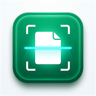

# OGDC PPA CamScanner Pro (PWA Edition)

Aplikasi Web Scanner Dokumen Digital berstandar **CamScanner** yang terintegrasi langsung dengan **Google Apps Script**, **Google Drive**, dan **Google Sheets**. Dilengkapi dengan kemampuan **Progressive Web App (PWA)** sehingga dapat langsung diinstal di layar utama perangkat Android, iPhone/iPad, Windows, dan MacOS.



---

## 🌟 Fitur Utama

- **Universal Dual-Engine Camera (Kompatibel Penuh iPhone & Huawei)**:
  - **Kamera Scan (Live Viewfinder WebRTC)**: Jendela bidik kamera langsung di layar browser dengan panduan bingkai dokumen A4, tombol senter/flash, pembalik kamera depan/belakang, dan rana instan tanpa keluar aplikasi.
  - **Kamera HP (Native Camera Intent)**: Jalur akses langsung ke aplikasi kamera bawaan sistem HP dengan penanganan event non-blocking.
  - **Solusi Kompatibilitas Khusus iOS Safari & Huawei EMUI/HarmonyOS**:
    - Menghilangkan `display: none` pada elemen input agar Safari iOS dan EMUI tidak memblokir event klik pengguna.
    - Validasi file toleran yang menerima foto kamera meskipun sistem operasi mengembalikan MIME-type kosong (`""`).
    - Pemuatan memori aman (*Zero-OOM*) menggunakan `URL.createObjectURL` dan auto-downscale ke 2400px untuk mencegah peramban me-refresh/crash saat memproses foto kamera resolusi tinggi (48MP/108MP).
    - Alur pemindaian beruntun (**+ Foto Lagi**) yang dapat membuka kamera berulang kali tanpa terhalang pembatasan gesture Safari iOS.

- **PWA (Progressive Web App) Installable**:
  - Tombol **"Pasang Aplikasi"** langsung di bilah navigasi atas (bebas halangan navigasi bawah).
  - Berjalan dalam mode *standalone* layar penuh tanpa bilah URL browser, persis seperti aplikasi native Android/iOS.
  - Dilengkapi panduan khusus untuk pengguna iOS Safari (*Add to Home Screen*) dan Android/Desktop.
  - Caching aset melalui Service Worker (`sw.js`) dan Web App Manifest (`manifest.json`).

- **Auto-Hide Sidebar Drawer & PIN Protected Shortcuts**:
  - Tombol hamburger menu di header untuk membuka navigasi samping (*slide-over drawer*).
  - Dilengkapi fitur *Auto-Hide* (otomatis tertutup saat klik overlay luar, tombol silang, atau navigasi).
  - Akses pintasan langsung ke **Database Google Sheets** (`Data_Transaksi`) dan **Folder Google Drive** (Arsip PDF).
  - Dilindungi sistem **Autentikasi PIN Keamanan (`0000`)** sebelum membuka akses penyimpanan.

- **Zero-Clipping Paper Bounds & Perimeter Preservation**:
  - Menjamin 100% isi kertas A4 atau ukuran lebih besar tetap utuh (kop surat, tabel terluar, nomor BA, dan tanda tangan tidak terpotong).
  - Menghapus pemotongan destruktif (*auto-trim*) dan penyusutan margin (*inset*), mengandalkan pemutihan latar belakang Magic Color.
  - Default otomatis mengunci tepat di tepi fisik terluar dokumen (100% area terjaga).

- **Instant 1-Click & Multi-Page Continuous Scan (Alur Cepat Beruntun)**:
  - Tombol **"+ Foto Lagi"**: Otomatis menerapkan Magic Color pada halaman saat ini dan langsung memicu kamera untuk mengambil foto halaman ke-2, ke-3, dst.
  - Tombol **"Selesai"**: Otomatis menerapkan Magic Color dan langsung menampilkan pratinjau halaman bersih di lembar kerja PDF.
  - Tidak perlu lagi mengklik tombol "Selesai" berulang kali di layar filter.
  - Pilihan filter (Magic Color, B&W, Grayscale, Asli) tetap dapat disesuaikan kapan saja di lembar kerja akhir.

- **Magic Color Filter & Anti-Fade Engine**:
  - *Morphological Background Illumination Division*: Menghapus bayangan tangan, bayangan ponsel, dan gradasi pencahayaan ruangan secara merata.
  - *Anti-Fade Curve*: Memutihkan kertas menjadi putih murni (`#ffffff`), sementara teks judul, tulisan tangan, garis tabel, dan nomor BA tetap hitam pekat dan tajam (tidak pudar).
  - *Color Seal & Stamp Preservation*: Tinta stempel merah dan tanda tangan pulpen biru tetap cerah dan tajam dengan saturasi yang diperkuat.

- **Form Input Transaksi Bersih (Clean Blank)**:
  - Seluruh kolom form (Tanggal, Shift, Jenis Transaksi, Vendor, Berkas, Nomer BA) hadir dalam keadaan **kosong polos** saat halaman dibuka.
  - Dilengkapi tombol cepat **Reset Form** (<i class="fa-solid fa-eraser"></i>).
  - `autocomplete="off"` mencegah browser mengisi data lama secara otomatis.

---

## 📲 Cara Memasang sebagai PWA

### 🤖 Android (Google Chrome / Samsung Internet)
1. Buka tautan Web App di browser ponsel.
2. Tekan tombol **"PASANG"** di pojok kanan atas bilah navigasi.
3. Tekan **"Pasang" / "Install"**.
4. Ikon **OGDC Scanner** akan muncul di layar utama (*Home Screen*) HP Anda.

### 🍎 iPhone / iPad (Safari)
1. Buka tautan Web App di Safari.
2. Tekan tombol **Bagikan (Share)** (ikon kotak dengan panah ke atas) di bilah bawah.
3. Gulir ke bawah dan pilih **"Tambah ke Layar Utama" (Add to Home Screen)**.
4. Tekan **Tambah (Add)** di pojok kanan atas.

### 💻 Windows / MacOS (Chrome / Edge)
1. Buka Web App di Google Chrome atau Microsoft Edge.
2. Klik ikon instalasi (<i class="fa-solid fa-download"></i>) di sebelah kanan *address bar* browser.
3. Klik **Install**. Aplikasi akan terbuka di jendela terpisah tanpa frame browser.

---

## 🛠️ Struktur File Proyek

```text
├── index.html          # Antarmuka Pengguna (UI), Logika Scanner & PWA Engine
├── Code.js             # Backend Google Apps Script (Drive & Sheets Handler)
├── manifest.json       # Web App Manifest untuk PWA
├── sw.js               # Service Worker untuk Caching & PWA
├── .nojekyll           # Bypass Jekyll untuk GitHub Pages
├── appsscript.json     # Manifest Konfigurasi Google Apps Script
├── .clasp.json         # Konfigurasi Google Clasp CLI
└── README.md           # Dokumentasi Proyek
```

---

## 🌐 Cara Mengaktifkan GitHub Pages (PWA Hosting)

Untuk dapat menginstal PWA secara langsung di perangkat ponsel atau komputer melalui GitHub:
1. Buka repositori di browser: [github.com/urdailymotion/CAM-SCANER-OGDC](https://github.com/urdailymotion/CAM-SCANER-OGDC)
2. Masuk ke tab **Settings** > **Pages** (di menu sebelah kiri).
3. Pada bagian **Build and deployment** > **Branch**:
   - Pilih Branch: **`main`**
   - Folder: **`/(root)`**
   - Klik **Save**.
4. Tunggu 1–2 menit, link PWA Anda akan aktif di:
   👉 **`https://urdailymotion.github.io/CAM-SCANER-OGDC/`**
5. Buka link tersebut di Google Chrome (Android/PC) atau Safari (iOS) untuk langsung memasang aplikasi PWA ke layar utama.

---

## 🚀 Deployment ke Google Apps Script via Clasp


Proyek ini telah dikonfigurasi untuk deployment instan menggunakan `@google/clasp`:

1. **Login Clasp**:
   ```bash
   npx @google/clasp login
   ```
2. **Push Perubahan**:
   ```bash
   npx @google/clasp push --force
   ```
3. **Deploy Versi Terbaru**:
   ```bash
   npx @google/clasp deploy -i <DEPLOYMENT_ID> -d "Deskripsi Update"
   ```

---

## 📄 Lisensi
Hak Cipta © 2026 PT Putra Perkasa Abadi (PPA) - Unit OGDC.
Seluruh hak cipta dilindungi undang-undang.
